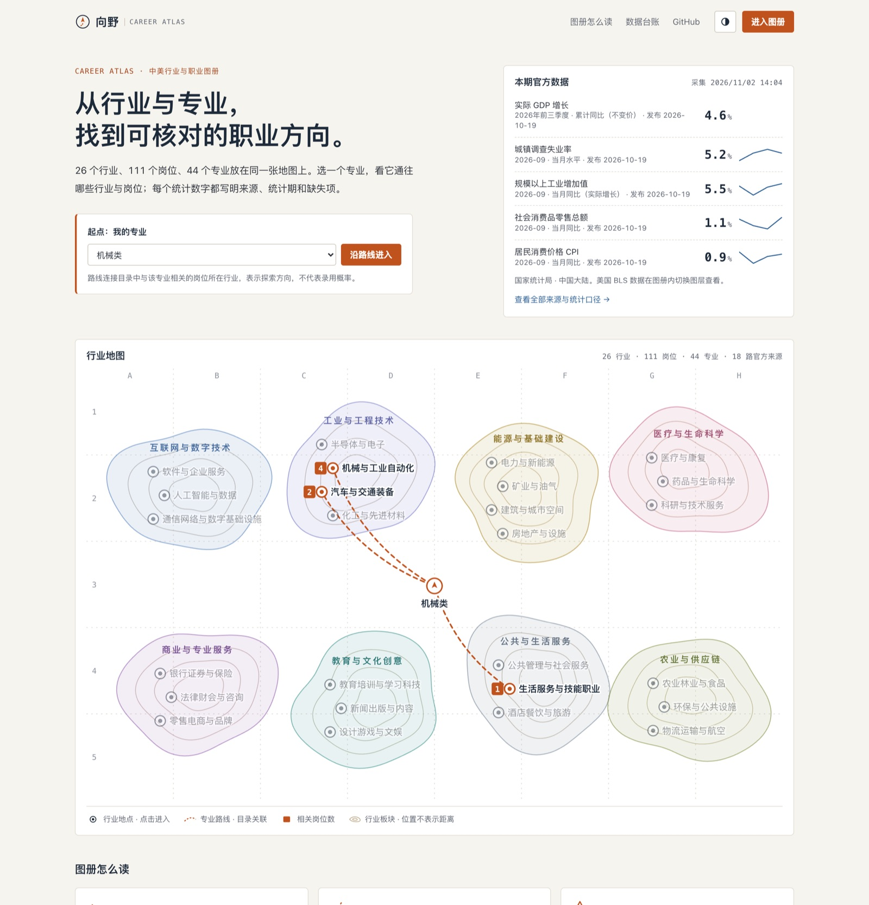
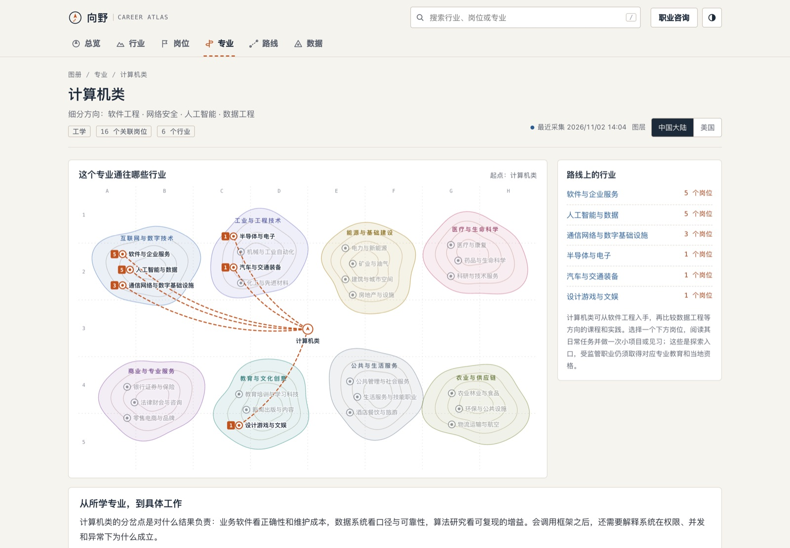
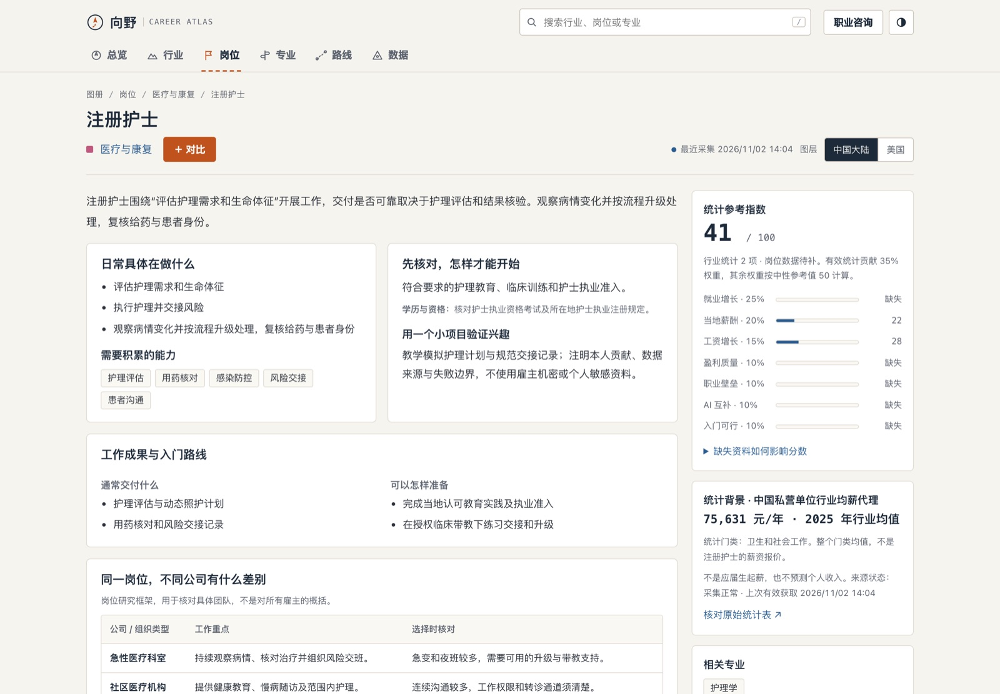
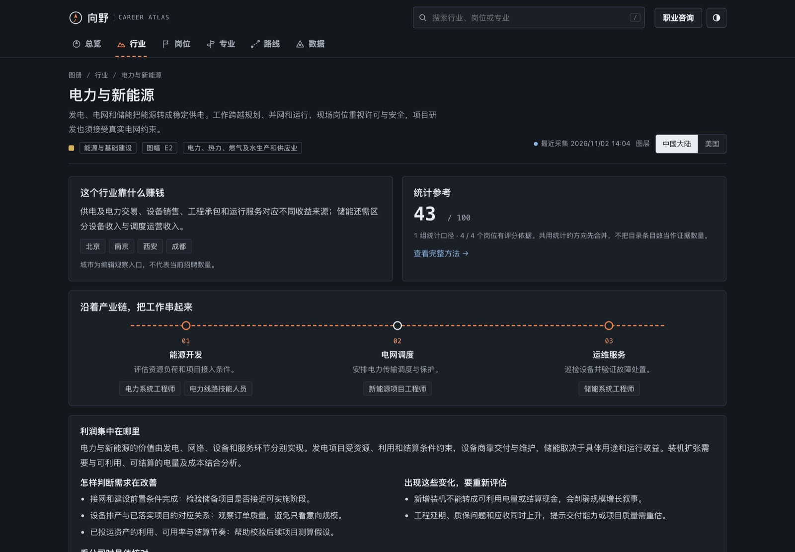
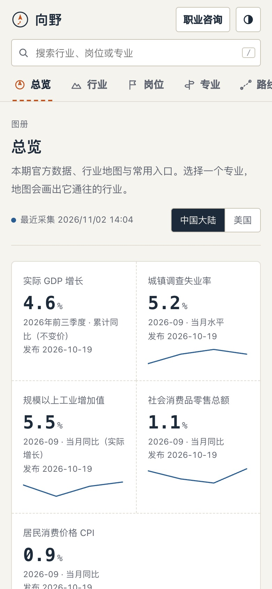

# 向野 · Career Atlas

By [Leon Wang](https://leon1111-wgl.github.io/)

**从行业与专业，找到可核对的职业方向。** 面向年轻人的中美行业、专业与岗位图册。中文首版，开放源码，官方统计自动更新；浏览器里的路线助手用规则规划、调用数据工具作答，每个数字写明来源和日期，并显示工具轨迹。当前版本 0.2.0，见[更新记录](CHANGELOG.md)。

**[打开网站](https://leon1111-wgl.github.io/career-atlas/)** · [路线助手说明](docs/ROUTE_ASSISTANT.md) · [前沿与业界做法](docs/FRONTIER_REVIEW.md) · [观察报告](reports/latest.md) · [评分代码](web/scoring.js) · [模型卡](docs/MODEL_CARD.md) · [设计说明](docs/DESIGN_REVIEW.md)

关键词：职业规划 · 专业选择 · 行业分析 · 毕业去向 · 就业统计 · 国家统计局 · BLS · 浏览器本地模型 · WebLLM



## 可以做什么

- **行业地图**：26 个行业按 8 个板块画成等高线地形图，每个行业是一个可点击的地点，图幅编号（如 E2）贯穿全站。选一个专业作为起点，地图画出它在目录中关联的行业与岗位数。路线表示探索方向，不代表录用概率。
- **本期官方数据**：首页直接列出国家统计局最新月度/季度指标（美国图层为 BLS 月度数据），统计期、发布日期和来源链接分开写；趋势支持逐期查值。
- **行业页**：谁付钱、谁交付，产业链每一段的岗位，增长驱动与约束，利润集中在哪里，同口径工资背景，相关政策如何传导到岗位，示例机构与进入前的核对清单。
- **岗位页**：111 个岗位，每个都有日常任务、交付成果、入门路线、3 类公司情境、面试核对问题、AI 分工、相邻方向；右侧台账列出统计参考指数的各维度、缺失项与原始统计表。最多选 3 个横向对比。
- **专业页**：44 个专业族的课程基础、三条职业路线、读研取舍，以及真实毕业去向表（BLS 学科职业分布、高校官方就业质量报告）画成的比例条，学校、年份和分母分别保留。
- **路线规划**：按专业和明确偏好生成探索清单，下载四周实践计划；公共部门报考路径单列。
- **数据台账**：18 路来源的统计期、频率、上次有效获取和采集状态，指数计算方法，政策核对记录，下载报告与原始快照。
- **路线助手**（0.2.0）：用自己的话问“我学会计，想转数据分析要补什么”“这个专业毕业去哪些行业，起薪有官方数据吗”。规则规划器（不用语言模型）识别专业、岗位与行业，调用数据工具：专业→岗位→行业、技能差距、相邻岗位路线、国家统计局与 BLS 统计、高校官方去向表、最新宏观指标、公共部门入口。每个数字附来源、统计期和日期；起薪、录用概率、具体公司薪酬、分城市收入、预测等现有数据回答不了的，直接说明原因。展开“规划与工具轨迹”可看每一步。约 12KB 的自训练意图分类器作为规划信号之一；可选加载的 Qwen3 0.6B 只在“资料检索”类回答里挑选补充依据。问题不上传。
- 浅色、深色、跟随系统三种外观；手机宽度可用，地图在窄屏可左右滑动。

| 专业页：路线与毕业去向 | 岗位页：任务与统计台账 |
| --- | --- |
|  |  |
| **行业页（深色）：产业链路线** | **手机** |
|  |  |

## 数据有多“实时”

GitHub Actions **每6小时尝试更新**，官方数据按月、季度或年度发布。采集时间与观测期分别标注。调度可能延迟，数据台账显示实际结果。只有发布的数值发生变化（或已提交快照的采集时间超过 3 天）时才提交快照；只有时间戳变化的刷新照常部署，但不再产生提交（[`scripts/data_changed.py`](scripts/data_changed.py)）。当前接入18路来源：世界银行4项中美年度指标、国家统计局行业工资、最新发布及月度/季度指标、FRED转发BLS的10项美国月度序列、BLS职业预测表。

遇到访问限制，使用公开可读的官方表格或官方数据分发渠道，不绕过登录/付费墙。BLS职业预测当前使用经官方网页核验的初始快照，自动HTTP抓取返回403时保留原值和原获取时间，标记“沿用快照”。后续直接抓取成功时自动替换。国家统计局最新发布页用于发现新的工资年报和月度/季度报告；成功获取不等于统计期推进。GDP累计同比、当月同比和失业率水平分别标注。[最新指标口径](docs/CURRENT_DATA.md)。

## 推荐指数与真实证据

统计与研究判断分开列示。指数仅使用已核对的就业预测、同口径工资及工资变化；缺失维度保留为空，合成时向中性参考值50收敛，避免将少量偏高数据放大。至少2项有效统计且合计权重35%才显示统计参考；未验证的岗位研究暂停计分。开放岗位含替代需求，保留背景但不再直接加分。行业汇总对共用统计去重，缺失组同样保留。[完整计算方法](docs/SCORING.md)。

中国行业年均工资与美国职业中位数、十年就业预测各自使用，不能跨国排名或解释为应届生起薪。研究规则尚未按长期就业结果验证。

专业研究覆盖44个专业族的课程基础、职业路径、发展能力、实践项目和学历取舍。真实毕业去向表被提取为结构化记录，进入专业详情、职业关联和模型检索；保持统计年、国家和样本人群。政策按原始发布日期展示，区分原文概要、实施状态与岗位传导研究，不因为政策支持就自动加分。每6小时核对已审核政策并发现官方新发布，未审核候选不进入分析。[政策来源](docs/POLICY_SOURCES.md)。

## 路线助手怎么做、怎么测

做法参照招聘平台的智能体：先把问题拆成计划，再调用岗位与技能工具并附依据（[LinkedIn Engineering，2025-10-21](https://www.linkedin.com/blog/engineering/ai/how-we-engineered-linkedins-hiring-assistant)）；本站的规划由规则完成，只读，数据只来自目录与公开统计。业界做法与取舍见 [FRONTIER_REVIEW](docs/FRONTIER_REVIEW.md)。

盲测：另一模型（Claude Sonnet 5.5）只看公开说明和名称清单写了 48 题（32 题应回答、16 题不应回答），在写任何助手代码前提交（`03d26f7`）。首轮在 `3c85af3` 上人工评分：应回答 18 对 / 6 部分 / 3 错 / 5 未答；不应回答 9 对 / 5 部分 / 0 错 / 2 未答，这 16 题里没有给出被禁止的数字。之后针对失败类别的修复不再算盲测。详见 [ROUTE_ASSISTANT](docs/ROUTE_ASSISTANT.md)。

自己提问：网站进入图册后点顶栏“路线助手”；或在本地运行与页面同一代码路径的命令：

```bash
node scripts/route-probe.mjs "我学会计，想转数据分析要补什么"
node scripts/route-probe.mjs --major mech "这个专业毕业去哪些行业，起薪数据有官方来源吗"
```

## 两个本地模型，各自负责什么

轻量问题分类器由本项目用192条原创中文问题训练，约12KB、8类问题意图。64条独立编写的开发评测中整体43条分类正确（67.19%）；16条回退通用检索。已接受的48条路由中43条正确（89.58%），这不等于整体准确率，也不等于职业建议正确率。明确的比较、工资和公共部门问题另有规则保证必要资料覆盖；所有答案由带来源的资料整理。[训练与评测](docs/INTENT_MODEL.md)。

以下为可选Qwen语言模型：

- 基座：Qwen3-0.6B；MLC 4-bit量化；运行时 WebLLM 0.2.86。
- 约335MiB模型仓库文件与WASM通过本项目GitHub Pages分发，不需要用户API Key或远程推理服务。
- 模型文件固定上游版本，发布时逐文件验证SHA256。
- 资料库、检索、推荐规则、提示约束和评测由本项目实现；**未宣称从零训练或微调基座**。
- 用户点击后才加载模型。需要WebGPU与足够内存；不支持时仍能使用检索、评分与报告。
- 本地完整推理已验收；2026-10-15公网冷启动测试在10分钟内未完成权重下载，GitHub Pages大文件速度取决于网络。下载较慢可先使用资料检索，或按下方命令下载发布包在本地运行。
- 不上传问题、专业偏好或聊天内容。仅显式保存时把偏好写入当前浏览器。

## 本地运行

Python 3.12+、Node.js 22+、curl。静态界面没有构建步骤和npm依赖。

```bash
python -m unittest discover -s tests -p 'test_*.py'
node --test tests/*.test.mjs        # 含路线助手的覆盖、数字来源与口径测试
python -m pipeline.build
python -m http.server 4173 --directory web
```

每个 PR 由 [`ci.yml`](.github/workflows/ci.yml) 运行全部 Python 与 Node 测试、分类器复现检查、报告生成和模块引用检查，通过后才合并到会自动发布的 main。

打开 `http://localhost:4173`。不下载模型也可使用全部数据页面和检索。要运行模型：

```bash
gh release download model-qwen3-0.6b-v1 --pattern qwen3-model.tar.gz
mkdir -p web/models/qwen3/resolve/main
tar -xzf qwen3-model.tar.gz -C web/models/qwen3/resolve/main
python scripts/verify-model.py web/models/qwen3/resolve/main
```

手动抓取与更新报告：

```bash
python -m pipeline.collect
python -m pipeline.build
```

`--offline` 保留现有数据和时间，不伪造更新。原始公开来源压缩件在 `content/raw/`，解析后的快照在 `web/data/observations.json`。BLS核验种子单独记录在 `content/bls-extract.txt`。

## 项目结构

| 目录 | 用途 |
| --- | --- |
| `pipeline/` | 有界抓取、解析、保留旧值、报告生成 |
| `content/` | 原创行业目录、开源参考、公开来源快照 |
| `web/` | 中文静态界面、可解释评分、检索、本地模型 |
| `tests/` | 国家/口径隔离、最新数据解析、缺失回退、评分、检索、问题分类、路线助手与模型协议 |
| `evals/route/` | 路线助手盲测集、给出题模型的说明、首轮运行与人工评分 |
| `reports/` | 可阅读和引用的最新报告 |
| `docs/` | 模型卡、目录说明、设计与数据审计 |

## 开源参考与许可

WebLLM实际集成，保留Apache-2.0许可；Qwen/MLC模型保留上游许可。Developer Roadmap、Interview Handbook、Reactive Resume与职业规划/考公社区仓库作为资料入口，逐一核查许可证，不把高星当作事实背书，不自动执行第三方skill。[来源审计](docs/SOURCE_AUDIT.md)。

原创代码与原创说明采用 [MIT](LICENSE)。第三方模型、运行时与数据分别遵守其自身条款，见 [第三方声明](THIRD_PARTY.md)。统计数字是研究背景；本项目不保证录用、收入或特定政策结果。

### 数据准备优先：中国大陆

目前已结构化5所高校官方资料中的217个数值，关联31个目录专业类别，保留5个原文未披露值；新增6条同一银行集团的历史招聘条件。学校、学历、年份、专业和分母独立保留，不把单校结果外推全国，也不由招聘条件推算录用难度。

工时、稳定性、真实录用漏斗与院校背景优势尚未有可比样本，停止使用编辑量规加分。综合推荐与完整优先级排序待数据基础完善后建设。维护方案见[数据基础](docs/DATA_FOUNDATION.md)、[来源与用途](docs/RECRUITMENT_SOURCES.md)、[当前缺口审计](reports/evidence-audit.md)。
